# Arquitectura

## Objetivos

1. **Una demo que no falle:** funciona sin internet desde una laptop, además del enlace público.
2. **Datos reales y reproducibles:** cada señal se puede recalcular y explicar desde los datos de origen.
3. **Costo casi nulo:** datos abiertos, herramientas libres y hosting gratuito.
4. **Lista para crecer:** datos y aplicación separados por interfaces claras, para cambiar las piezas sin reescribir todo.
5. **Construible en 12 días** por 4 estudiantes de sistemas.

## Plataforma: web responsiva

Decisión en el [ADR 0001](../adr/0001-aplicacion-web-responsiva.md).

| Opción | A favor | En contra | Veredicto |
|---|---|---|---|
| **Web responsiva** | Un enlace para el jurado y los validadores; uso en escritorio; un solo código; despliegue gratuito | Experiencia móvil menos rica | **Elegida** |
| Android nativo | Notificaciones | El usuario trabaja en escritorio; hay que instalar un APK; no sirve para iOS | Descartada |
| iOS nativo | — | Requiere Mac, cuenta de desarrollador y TestFlight; sin beneficio para el usuario | Descartada |
| Flutter (web y móvil) | El equipo ya lo conoce | Para tablas, gráficos y accesibilidad de un panel de datos, el ecosistema web es más maduro | Descartada para el MVP |

## Vista general

```mermaid
flowchart LR
  A["OCP Data Registry<br/>Perú OECE · OCDS · CC BY 4.0"] -->|"descarga oficial .jsonl.gz"| B["pipeline: ingest<br/>filtra La Libertad y años"]
  B --> C["pipeline: normalize<br/>tablas Parquet con DuckDB"]
  C --> D["pipeline: signals<br/>señales propias S01–S06"]
  C --> E["Cardinal<br/>prepare + indicators"]
  E --> D
  D --> F["pipeline: priority<br/>prioridad de revisión"]
  F --> G["pipeline: export<br/>seudonimiza + paquete de datos + manifiesto"]
  G --> H["web: StaticDataSource"]
  H --> I["Panel · Bandeja · Fichas · Metodología"]
  I --> J["Revisión humana<br/>LocalReviewStore · roles simulados"]
  J --> K["Reporte de trazabilidad"]
```

## Componentes

### `pipeline/` (Python + uv + DuckDB)

Decisión en el [ADR 0004](../adr/0004-pipeline-python-duckdb.md). Cada paso lee y escribe archivos, así que se puede ejecutar y probar por separado.

| Paso | Qué hace | Salida |
|---|---|---|
| `ingest` | Lee el `.jsonl.gz` por streaming y filtra por departamento y años | `data/interim/*.jsonl` |
| `normalize` | Separa el OCDS en tablas: procesos, postores, adjudicaciones, contratos, proveedores, entidades, ítems y documentos | `data/derived/*.parquet` |
| `cardinal` | Ejecuta `ocdscardinal prepare` e `indicators` con nuestro `settings.ini` | `data/derived/cardinal.json` |
| `signals` | Calcula S01–S06 con parámetros de configuración y guarda las entradas y la comparación de cada resultado | `senales.parquet` |
| `priority` | Aplica los pesos y asigna el nivel de prioridad | `prioridad.parquet` |
| `export` | Seudonimiza, arma el paquete de datos para la web y escribe un manifiesto (fecha de corte, versión de las reglas, conteos y exclusiones) | `web/data/publico/` y `web/data/local/`, según el [contrato del paquete de datos](contrato-paquete-de-datos.md) |

### `web/` (Next.js + TypeScript + Tailwind CSS + shadcn/ui)

Decisión en el [ADR 0005](../adr/0005-web-nextjs-shadcn.md). Las pantallas están descritas en el [sistema de diseño](../diseno/sistema-de-diseno.md#pantallas).

| Ruta | Pantalla |
|---|---|
| `/` | Panel de la entidad |
| `/senales` | Bandeja de señales priorizada |
| `/procesos/[ocid]` | Ficha del proceso |
| `/proveedores/[id]` | Ficha del proveedor |
| `/revision` | Mis revisiones y asignaciones |
| `/reporte/[ocid]` | Reporte de trazabilidad imprimible |
| `/metodologia` | Señales, fuentes, licencias y límites |

Dos interfaces separan la interfaz de usuario de sus datos:

- **`DataSource`** (lectura): `getEntitySummary`, `listSignals(filtros)`, `getProcess(ocid)` y `getSupplier(id)`. En el MVP se implementa como `StaticDataSource`, que lee el paquete generado por el pipeline. Más adelante será `ApiDataSource`.
- **`ReviewStore`** (revisiones): `listReviews`, `saveDecision` y `assign`. En el MVP es `LocalReviewStore`, en el almacenamiento del navegador. Más adelante será `ApiReviewStore` con PostgreSQL.

**Roles simulados:** analista de integridad (revisa y decide), jefatura (recibe asignaciones y cierra) y auditor (solo lectura). Se eligen desde un selector en la cabecera.

## Modelo de datos derivado

| Tabla | Clave | Columnas principales |
|---|---|---|
| `procesos` | `ocid` | entidad, método, objeto, fechas de convocatoria y de presentación, monto referencial, número de postores, estado |
| `postores` | `ocid`, `proveedor_id` | — |
| `adjudicaciones` | `award_id` | ocid, proveedor, monto, fecha |
| `contratos` | `contract_id` | ocid, award, monto, monto final, fecha de término |
| `proveedores` | `proveedor_id` (RUC) | nombre, tipo (persona natural o jurídica), seudónimo |
| `entidades` | `entidad_id` | nombre, tipo, departamento |
| `items` | `ocid`, `item_id` | clasificación, descripción, cantidad |
| `documentos` | `ocid`, `doc_id` | tipo, título, URL oficial |
| `senales` | `senal_id` | código, nivel, objeto (ocid, proveedor o entidad), valor, umbral, grupo de comparación, versión de la regla, entradas |
| `prioridad` | `ocid` | puntaje, nivel, desglose |

## Despliegue

- **Enlace público:** Vercel (plan gratuito) o un servicio equivalente, con el paquete de datos seudonimizado.
- **Respaldo:** la misma aplicación ejecutándose en una laptop con los datos incluidos y sin internet, más el video de la demo.
- **Datos:** el paquete se regenera con el pipeline. El manifiesto indica la fecha de corte que se muestra en la cabecera.

## Requisitos no funcionales

| Tema | Meta |
|---|---|
| Rendimiento | La bandeja y las fichas cargan en menos de 1 s con el conjunto de La Libertad en una laptop común |
| Accesibilidad | WCAG 2.2 AA: contraste, teclado, lectores de pantalla y nunca solo color |
| Privacidad | Seudonimización de proveedores en el enlace público; las personas naturales nunca aparecen con nombre; sin analítica de usuarios |
| Transparencia | Página de metodología, atribución CC BY 4.0, versión de las reglas y fecha de corte visibles |
| Seguridad | Sin backend en el MVP, lo que reduce la superficie de ataque; sin secretos; dependencias revisadas con `npm audit` y `pip-audit` |

## Ruta de escalamiento

Sirve para el criterio de viabilidad, impacto y sostenibilidad.

| Fase | Qué agrega |
|---|---|
| 1 · MVP (hackathon) | Una región, señales núcleo, revisión local en el navegador |
| 2 · Piloto en una entidad | API (FastAPI) + PostgreSQL, inicio de sesión institucional, revisiones compartidas, actualización mensual automática desde el OCP Data Registry y fuente de sanciones (S07) |
| 3 · Integración | Carga de expedientes internos (requerimientos, conformidades, pagos) para la trazabilidad completa, más INFOBRAS para obras |
| 4 · Escala | Varias entidades y regiones, comparación entre pares y un portal ciudadano de solo lectura |

## Riesgos técnicos

| Riesgo | Mitigación |
|---|---|
| Los datos no traen un campo que necesita una señal | Spike el primer día; reemplazar la señal por otra del catálogo |
| Cardinal no cubre los datos del Perú | Señales propias según la guía de OCP; Cardinal solo para contrastar |
| El archivo es grande para la laptop | Lectura por streaming y filtro temprano por La Libertad |
| Falla el internet en la presentación | Ejecución local y video de respaldo |
| Falta tiempo | Alcance mínimo: S01–S04, bandeja, ficha del proceso y revisión |
