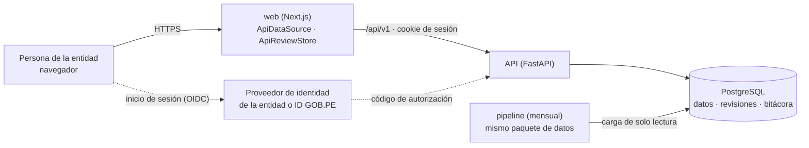
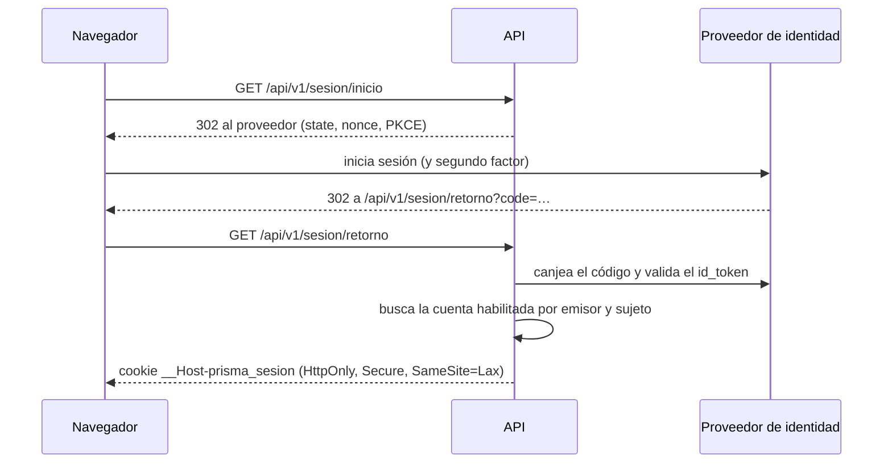

# Backend del piloto (diseño)

Diseño del servidor para el **piloto en una entidad**, la fase 2 de la [ruta de escalamiento](../arquitectura.md#ruta-de-escalamiento). No confundir con la Fase 2 del cronograma de la hackathon. La decisión está en el [ADR 0009](../../adr/0009-backend-del-piloto.md).

> **Estado:** solo diseño. No se construye antes del Stage-Gate 1. El MVP sigue sin backend y la demo no cambia.

| Archivo | Contenido |
|---|---|
| Este documento | Componentes, inicio de sesión, permisos, bitácora, migración de la web, seguridad y privacidad |
| [`api.openapi.yaml`](api.openapi.yaml) | Contrato de la API (OpenAPI 3.1) |
| [`esquema.sql`](esquema.sql) | Tablas de PostgreSQL, permisos de la base y bitácora encadenada |

## Qué resuelve

| Hoy, en el MVP | En el piloto |
|---|---|
| Cada navegador guarda sus revisiones | Las revisiones se comparten en la entidad |
| El rol se elige desde un selector | El rol viene de la sesión, y la sesión, del proveedor de identidad de la entidad |
| El historial dice qué rol decidió | La bitácora dice qué persona, con qué cargo y cuándo |
| Se puede borrar `localStorage` | Nada se edita ni se borra; si alguien altera la base, la cadena de hashes se rompe y se detecta |
| Datos del paquete estático | Los mismos datos, cargados en PostgreSQL y actualizados cada mes |

## Componentes

- La web y la API se publican bajo el **mismo dominio** (la API en `/api/v1`), para que la cookie de sesión sea del mismo sitio y no haga falta abrir CORS.
- La API es la única que habla con la base y con el proveedor de identidad. El navegador nunca recibe tokens del proveedor.
- El pipeline no cambia su lógica: genera el mismo paquete, y un paso nuevo, por definir en el piloto, lo carga en el esquema `datos`.

## Inicio de sesión e identidad

### Quién autentica

**Prisma no guarda contraseñas.** Delega el inicio de sesión por **OpenID Connect** (flujo de código de autorización con PKCE) a uno de estos proveedores, según lo que use la entidad del piloto:

1. **El directorio institucional de la entidad**, el mismo con el que la persona entra a su correo. Es lo más simple para el piloto.
2. **ID GOB.PE**, la plataforma de autenticación del Estado peruano, si la entidad la tiene habilitada. La forma de integrarla se confirma con la Secretaría de Gobierno y Transformación Digital.

Para pruebas locales y de integración se usa un proveedor OIDC de pruebas (por ejemplo, Keycloak en un contenedor), nunca uno real.

### Face ID, huella y passkeys

En una web, Face ID y la huella se usan mediante **passkeys (WebAuthn)**. El navegador le pide al sistema operativo que verifique a la persona; **el dato biométrico nunca sale del dispositivo** y Prisma solo guarda una clave pública.

- **Si el proveedor de identidad ya exige un segundo factor**, Prisma lo comprueba en el `id_token` (claim `amr`) y no pide otro.
- **Si no lo exige**, Prisma registra una passkey propia como segundo factor (tabla `seguridad.passkeys`).
- **Acciones sensibles**, como decidir "requiere atención", importar revisiones o cambiar roles, exigen haber verificado la identidad en los últimos 15 minutos. Si pasó más tiempo, la API responde `401` con el código `reautenticacion_requerida` y la web pide la passkey de nuevo.

### Por qué no RENIEC ni el DNI

- **No hay una API pública de RENIEC.** El acceso oficial es para entidades con convenio, mediante la Plataforma de Interoperabilidad del Estado (PIDE). Si la entidad del piloto ya verifica identidades con RENIEC, eso ocurre en su proveedor de identidad, no en Prisma.
- **Las APIs de terceros que consultan el DNI quedan descartadas.** No tienen una base legal clara bajo la Ley 29733, y las bases piden no saltar restricciones de acceso.
- **Un DNI no autentica.** Consultarlo solo confirma que el número existe y a nombre de quién está; no prueba quién está frente a la pantalla.
- **No guardamos el DNI.** Para identificar a la persona basta el par emisor y sujeto del proveedor de identidad.

### Cuentas

1. El administrador de la entidad registra a cada persona con su correo institucional, su cargo y su rol.
2. En el primer inicio de sesión, la API enlaza la cuenta si el correo del `id_token` está verificado y coincide. Desde entonces la reconoce por emisor y sujeto, aunque el correo cambie.
3. Si la cuenta no existe o está desactivada, la API responde `403` y la web muestra "Tu cuenta no tiene acceso a Prisma. Pide acceso al administrador de tu entidad."
4. Las sesiones viven en la base (`seguridad.sesiones`) y duran 8 horas. Cerrar sesión o desactivar la cuenta las revoca al instante.

**Datos personales que se guardan:** nombre, correo institucional, cargo, entidad y rol. Nada más: ni DNI, ni foto, ni datos biométricos.

## Roles y permisos

El rol viene de la cuenta, nunca de un parámetro que envíe el navegador. El servidor aplica la misma tabla que hoy resuelve `canReview(rol, accion)`, con dos cambios: aparece el rol `administrador` y desaparece el reinicio de la demostración.

| Acción | Analista | Jefatura | Auditor | Administrador |
|---|---|---|---|---|
| Leer panel, bandeja, fichas e historial de revisiones | Sí | Sí | Sí | Sí |
| Registrar una decisión | Sí | Sí | — | — |
| Asignar un caso | Sí | Sí | — | — |
| Exportar revisiones | Sí | Sí | Sí | — |
| Importar revisiones de la demostración | Sí | Sí | — | — |
| Ver y verificar la bitácora completa | — | — | Sí | Sí |
| Registrar, desactivar o cambiar el rol de una cuenta | — | — | — | Sí |

- **Separación de funciones:** el administrador gestiona cuentas pero no decide casos, y **nadie puede cambiar su propio rol**.
- **Cada entidad ve solo lo suyo.** Todas las tablas con datos de la entidad usan Row Level Security de PostgreSQL. Al inicio de cada transacción, la API fija `prisma.cuenta_id` con la cuenta de la sesión, y la base deduce de ahí la entidad y el rol.

## Bitácora encadenada

Es la respuesta concreta a la pregunta "¿quién hizo qué?". Está definida en [`esquema.sql`](esquema.sql).

**Qué se registra:** inicio y cierre de sesión, intentos de una cuenta desactivada, verificaciones con passkey, decisiones, asignaciones, exportaciones, importaciones, registro y desactivación de cuentas, cambios de rol y cada verificación de la cadena. No se registra cada lectura de una ficha, para no vigilar a las personas más de lo necesario.

**Cómo funciona:**

1. Solo se escribe mediante la función `auditoria.registrar(...)`, que bloquea la cadena de la entidad, lee el hash de la última fila, calcula `hash = SHA-256(hash_anterior ‖ contenido)` e inserta la fila nueva. Las filas de una entidad forman una cadena numerada (`secuencia` 1, 2, 3…).
2. La decisión o la asignación y su fila de bitácora se insertan **en la misma transacción**: si una falla, no queda ninguna. La fila guarda la huella SHA-256 del evento, así que la cadena también protege los comentarios y las notas.
3. La API no tiene permiso de `UPDATE` ni `DELETE` sobre la bitácora ni sobre las revisiones: las lee y escribe solo mediante funciones de la base. Además, un trigger rechaza cualquier `UPDATE`, `DELETE` o `TRUNCATE` en esas tablas, venga de quien venga.
4. `auditoria.verificar(entidad)` recalcula toda la cadena y devuelve la primera fila que no coincide. El auditor la ejecuta desde `POST /api/v1/bitacora/verificaciones`, y la propia verificación queda registrada.

**Límite honesto:** quien administre el servidor de base de datos con permisos totales podría reescribir la cadena completa y recalcular todos los hashes. Para detectarlo, el **sello diario** (el hash de la última fila de cada día) sale de la base: se imprime en el reporte de trazabilidad y lo guarda el auditor. Si la cadena cambia después, ya no coincidirá con los sellos anteriores. En una fase posterior, el sello se puede firmar digitalmente.

**Quién la ve:** el auditor y el administrador de la entidad. La bitácora nunca se muestra en el enlace público ni en un futuro portal ciudadano. El historial de revisiones de cada proceso sigue visible para todos los roles de la entidad, como hoy en la ficha.

## Cambios en la web

La interfaz ya separa las pantallas de sus datos ([arquitectura](../arquitectura.md#componentes)), así que el piloto reemplaza dos piezas.

### `DataSource` → `ApiDataSource`

Sus métodos ya devuelven promesas y cada uno tiene su endpoint de lectura en la API (`GET /api/v1/entidades`, `GET /api/v1/procesos/{ocid}`, etc.). Las pantallas no cambian.

### `ReviewStore` → `ApiReviewStore`

Hoy la interfaz es síncrona porque lee `localStorage`. `ApiReviewStore` mantiene la misma lectura síncrona desde una copia en memoria, que es lo que necesita `useSyncExternalStore`, y cambia lo que debe cambiar:

| Método de hoy | En `ApiReviewStore` |
|---|---|
| `listReviews`, `getState`, `listAssignedTo`, `listAssignedBy`, `listDecided`, `getSnapshot` | Leen la copia en memoria, cargada con `GET /api/v1/revisiones` |
| `saveDecision` | `POST /api/v1/procesos/{ocid}/decisiones`. Devuelve una promesa |
| `assign` | `POST /api/v1/procesos/{ocid}/asignaciones`. Devuelve una promesa |
| `exportReviews` | `GET /api/v1/revisiones/exportacion`, formato versión 2 |
| `importReviews` | `POST /api/v1/revisiones/importaciones`. Las entradas quedan marcadas como importadas, con quién las importó |
| `resetDemo` | No existe: en el piloto nada se borra. Lanza un error |
| `syncFromStorage` | Vuelve a consultar la API. La copia también se refresca al volver a la pestaña y cada 60 segundos |
| `subscribe`, `getServerSnapshot` | Sin cambios |

- **El parámetro `role` se ignora**, porque el servidor usa el rol de la sesión. Se conserva en la firma para no tocar a quienes la llaman.
- **Cada entrada suma un campo `autor`** (`{ id, nombre, cargo }`). En las entradas importadas, `autor` es `null` y `importado_por` dice quién las cargó.
- **Qué hacer desde ya:** llamar `saveDecision` y `assign` con `await`, como permite el [README del Lote D](../../../web/src/features/revision/README.md). Así, el cambio a promesas no toca las pantallas.
- **Formato de exportación versión 2:** `{ version: 2, entidad_id, exportado_en, exportado_por, entradas: [...], sello: { secuencia, hash } }`. El sello permite comprobar después que el archivo coincide con la bitácora.

## Seguridad

| Tema | Medida |
|---|---|
| Referencia | OWASP ASVS 5.0, nivel 2, como lista de comprobación antes del piloto |
| Transporte | Solo HTTPS, con HSTS |
| Sesión | Cookie `__Host-prisma_sesion`: `HttpOnly`, `Secure`, `SameSite=Lax`, sin `Domain` |
| CSRF | Toda petición que cambia datos exige la cabecera `X-Prisma-CSRF` con el token de `GET /api/v1/sesion` |
| CORS | Cerrado: la web y la API comparten origen |
| Fuerza bruta | Límite de peticiones en el inicio de sesión y en las escrituras, por cuenta y por IP |
| Validación | Pydantic en todas las entradas. Los comentarios se guardan como texto plano y la web nunca los interpreta como HTML |
| Base de datos | Tres usuarios: `prisma_migraciones` (dueño del esquema), `prisma_api` (lee y escribe solo por funciones) y `prisma_carga` (solo el esquema `datos`). Row Level Security por entidad |
| Secretos | Variables de entorno, documentadas en un `.env.example` sin valores. Nada en el repositorio |
| Registros técnicos | Sin datos personales ni comentarios de revisión. Lo personal solo va en la bitácora |
| Respaldos | Diarios y cifrados, con una prueba de restauración al mes |
| Dependencias | `pip-audit` y `npm audit` en cada PR, como en el MVP |

## Privacidad (Ley 29733)

- **Finalidad única:** registrar quién revisa cada caso y cuándo, para la rendición de cuentas dentro de la entidad.
- **Banco de datos personales:** antes del piloto, la entidad lo inscribe ante la Autoridad Nacional de Protección de Datos Personales.
- **Aviso de privacidad** en el primer inicio de sesión: qué se guarda, para qué, quién lo ve y por cuánto tiempo.
- **Conservación:** la bitácora no se borra durante el piloto. El plazo final se acuerda con la entidad según su normativa de archivo.
- **Cambia una regla del MVP:** hoy Prisma no guarda datos personales de quienes la usan ([sistema de diseño](../../diseno/sistema-de-diseno.md#ética-y-privacidad)). En el piloto guarda los de las cuentas, solo para la bitácora. Esa sección se actualiza cuando empiece el piloto.
- **Proveedores:** no cambia nada. Las personas naturales (RUC que empieza con 10) nunca muestran su nombre, en ningún modo.
- **Sin analítica de usuarios**, igual que en el MVP. La bitácora registra acciones de control, no hábitos de navegación.

## Fuera de alcance

- Consultas a RENIEC o a cualquier servicio que resuelva un DNI.
- Guardar datos biométricos, fotos o firmas manuscritas.
- Notificaciones por correo o en tiempo real (se pueden evaluar después del piloto).
- Portal ciudadano (fase 4).
- Firma digital del reporte (fase posterior; el sello diario la prepara).

## Orden sugerido de construcción

Para cuando empiece el piloto, con una parte por rama, como en el MVP:

1. Esquema, bitácora y sus pruebas: verificar la cadena, rechazar `UPDATE` y `DELETE`, y aislar entidades con Row Level Security.
2. Inicio de sesión OIDC con el proveedor de pruebas, sesiones y CSRF.
3. Endpoints de revisiones, con la tabla de permisos.
4. `ApiReviewStore` en la web, con las pruebas actuales de `ReviewStore` corriendo contra las dos implementaciones.
5. Carga del paquete de datos en el esquema `datos` y `ApiDataSource`.
6. Passkeys y reautenticación para acciones sensibles.
7. Revisión con la lista de OWASP ASVS y prueba de carga, como en las [pruebas del MVP](../pruebas-de-carga-y-seguridad.md).

## Decisiones abiertas

| Tema | Depende de |
|---|---|
| Dónde se aloja (nube o centro de datos de la entidad) | La entidad del piloto y su área de TI |
| Qué proveedor de identidad se usa | El directorio que ya tenga la entidad y si usa ID GOB.PE |
| Si la jefatura también ve la bitácora completa | El flujo de control interno de la entidad |
| Plazo de conservación de la bitácora | La normativa de archivo de la entidad |
